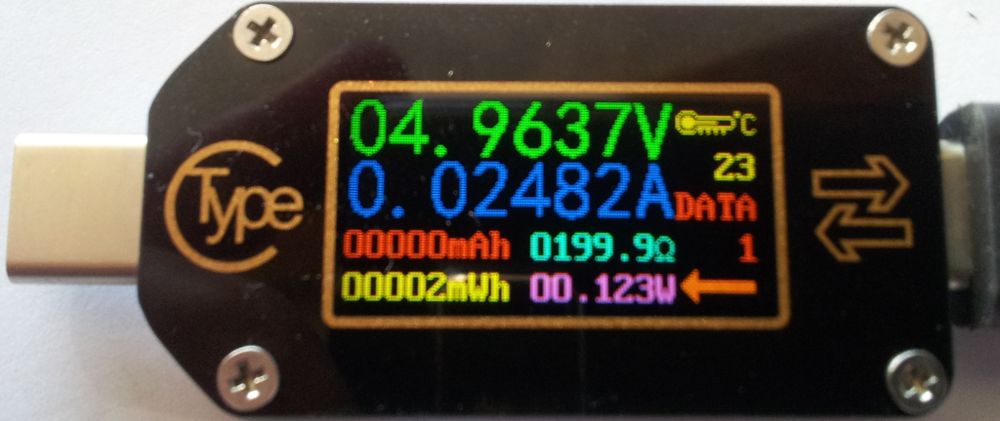

# TC66C — pembacaan USB serial dan Bluetooth LE



Sumber gambar: [sigrok — Rdtech-tc66c-mugshot.png](https://sigrok.org/wiki/File:Rdtech-tc66c-mugshot.png).

Script untuk menguji pembacaan RDTech TC66C di Windows, mendekripsi paket AES-256 ECB, memeriksa header `pac1`/`pac2`/`pac3` dan CRC-16/MODBUS, serta menyimpan data ke CSV.

## Persiapan

1. Nyalakan TC66C. Untuk serial USB, hubungkan port micro-USB komunikasi perangkat ke komputer memakai kabel data. Untuk BLE, aktifkan Bluetooth komputer dan pastikan tidak ada aplikasi HP/vendor yang sedang terhubung ke TC66C.
2. Buka PowerShell dan jalankan:

   ```powershell
   cd C:\Users\hendri\Tools\tc66c_monitor
   python -m pip install pyserial bleak cryptography
   ```

Lingkungan yang berhasil diuji: Windows, Python 3.13.12, TC66 firmware 1.12. Gunakan PowerShell biasa dengan akses perangkat; sandbox dapat membatasi serial atau Bluetooth.

## Cara penggunaan

USB serial saja, 30 pembacaan pada COM29:

```powershell
python -u tc66c_test.py --mode serial --port COM29 --polls 30
```

Bluetooth LE saja, 30 pembacaan; script mencari perangkat bernama TC66C atau yang mengiklankan service FFE5:

```powershell
python -u tc66c_test.py --mode ble --polls 30
```

Serial lalu Bluetooth:

```powershell
python -u tc66c_test.py --mode both --port COM29 --polls 30
```

Tanpa argumen, script memakai mode `both`, COM29, dan 30 pembacaan. Ganti `--port` bila nomor USB COM berubah. **COM3 dan COM4 diblokir oleh script sesuai instruksi pengguna.** BLE berkomunikasi langsung melalui GATT dan tidak memakai COM port.

Untuk menyimpan keluaran terminal:

```powershell
python -u tc66c_test.py --mode ble --polls 30 | Tee-Object -FilePath ble_run.log
```

Hentikan dengan Ctrl+C. CSV ditulis setelah rangkaian pembacaan selesai; menghentikan di tengah proses dapat membuat CSV sesi itu belum tersimpan.

## Hasil keluaran

Contoh pembacaan berhasil:

```text
BLE 1 {'time': '2026-10-07 05:57:32', 'model': 'TC66', 'firmware': '1.12', 'V': 5.1722, 'I': 0.00054, 'W': 0.0027, 'temperature': 24, 'crc_ok': True}
```

- `V`: volt; `I`: ampere; `W`: watt.
- `temperature`: nilai suhu dengan satuan mengikuti pengaturan perangkat.
- `crc_ok=True`: seluruh checksum tiga blok valid. Baris dengan `False` tetap disimpan tetapi integritasnya tidak terverifikasi.
- Kesalahan panjang paket atau header ditampilkan sebagai `SERIAL ERROR` / `BLE ERROR` dan tidak masuk CSV.

Hasil disimpan di folder `tc66c_results` di sebelah script, termasuk jika script dijalankan dari folder lain:

- `serial.csv`: pembacaan serial.
- `ble_0.csv` atau `ble_1.csv`: pembacaan BLE dari percobaan koneksi pertama atau kedua.
- `serial_*.bin` dan `ble_*.bin`: paket mentah untuk diagnostik.

**Nama hasil dipakai ulang dan ditimpa pada pengujian berikutnya.** Salin folder hasil terlebih dahulu jika ingin menyimpan bukti pengujian sebelumnya. File lama yang tidak ditimpa bisa tetap ada; cocokkan timestamp CSV dan log dengan sesi yang sedang diperiksa. Script ini melakukan uji terbatas, bukan monitor tanpa batas.

## Protokol dan pemecahan masalah

USB menggunakan 115200 8N1, perintah `query` dan `getva`. BLE subscribe notifikasi FFE4 pada service FFE0, lalu mengirim `bgetva\r\n` ke FFE9 pada service FFE5 memakai **`response=True`**. Pada unit yang diuji, pengiriman tanpa respons tidak menghasilkan data.

Jika serial gagal dibuka, periksa nomor COM USB dan tutup aplikasi lain yang memakai port tersebut. Jika BLE tidak ditemukan atau gagal terhubung, tutup koneksi HP/vendor, dekatkan perangkat, periksa Bluetooth, lalu cabut-colok daya TC66C dan coba ulang.

## Penggunaan dengan sigrok-cli

Masuk ke folder proyek melalui PowerShell:

```powershell
cd C:\Users\hendri\Tools\tc66c_monitor
```

Deteksi perangkat melalui USB serial COM29 (berhasil pada pengujian):

```powershell
sigrok-cli -d rdtech-tc:conn=COM29 --scan
```

Pembacaan selama 2 detik (berhasil menghasilkan 20 frame pada satu sesi):

```powershell
sigrok-cli -d rdtech-tc:conn=COM29 --time 2000
```

Angka `2000` adalah durasi dalam milidetik. Contoh hasil sesi berhasil:

```text
V: 5.1557 V
I: 2.17 mA
D+: 2.47 V
D-: 2.47 V
E0: 5 mWh
E1: 0 mWh
```

Untuk mengumpulkan log diagnostik, gunakan perintah yang dipakai pada sesi pengujian berhasil:

```powershell
sigrok-cli -l 5 -d rdtech-tc:conn=COM29 --time 2000 > sigrok_serial_diagnostic.log 2>&1
```

**Pembacaan belum konsisten:** pengulangan perintah 2 detik gagal dengan `Invalid poll response packet (magic values)`. Perintah `--frames 4` juga gagal pada dua percobaan. Batas waktu bukan perbaikan pasti. Bluetooth melalui `bt/dialog/...` tidak tersedia pada build Windows sigrok-cli yang terpasang. COM3 dan COM4 tidak digunakan.

Lihat [laporan sigrok-cli dan log pengujian](SIGROK_REPORT.md).

## Hasil pengujian tersimpan

Serial Python: **30/30 pembacaan valid**. BLE: **30/30 pembacaan valid**, alamat saat pengujian `82:EA:CA:10:0D:05`. Pada sigrok-cli terpasang, scan COM29 berhasil tetapi akuisisi gagal dengan `Invalid poll response packet (magic values)`; sebab internalnya belum terkonfirmasi.

Lihat [laporan lengkap](tc66c_results/REPORT.md), [data serial](tc66c_results/serial.csv), dan [data BLE](tc66c_results/ble_0.csv).

Referensi protokol: [sigrok — RDTech TC66C](https://sigrok.org/wiki/RDTech_TC66C).

Uji ulang langsung dengan sigrok-cli: lihat [laporan sigrok](SIGROK_REPORT.md). Serial menghasilkan 20 frame pada satu sesi, tetapi tiga sesi akuisisi lainnya gagal validasi paket. Transport Bluetooth pada build terpasang tidak tersedia.
